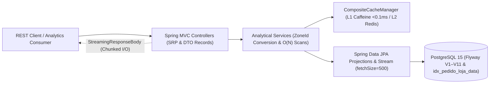

# Sinatra Mini — Multi-Store Sales Analytics SaaS API (`Java 17` · `Spring Boot 3.2`)

[](https://github.com/evslopes/sinatra-mini/actions/workflows/ci.yml)


> 🇺🇸 **EN:** High-throughput **Multi-Store Sales Analytics SaaS API** engineered in **Java 17** and **Spring Boot 3.2**, designed for **constant-memory CSV streaming (`100k+` rows without Heap OOM)**, **`O(N)` linear-scan time-series analytics**, **composite JPA indexing**, **Flyway-versioned PostgreSQL (`V1–V11`)**, **multi-tier caching (`L1 Caffeine` + `L2 Redis`)**, **Testcontainers integration suites**, and **Kubernetes HPA (`3–10` replicas)**.  
> 🇧🇷 **PT:** Plataforma **SaaS de Análise de Vendas Multi-Loja** em **Java 17** e **Spring Boot 3.2**, projetada para **exportação CSV em memória constante via streaming (`100k+` registros sem OOM)**, **algoritmos analíticos lineares `O(N)`**, **indexação composta JPA**, **migrações Flyway em PostgreSQL (`V1–V11`)**, **cache em duas camadas (`L1 Caffeine` + `L2 Redis`)**, **suíte de integração com Testcontainers** e **manifestos Kubernetes com HPA (`3–10` pods)**.

---

## Arquitetura & Fluxo de Engenharia de Performance



### Destaques Técnicos Principais

| Pilar de Engenharia | Problema Clássico em Produção | Solução Adotada neste Repositório |
| :--- | :--- | :--- |
| **Streaming Analítico `O(1)` Memória** | `findAll()` materializa milhares de entidades JPA na Heap causando `OutOfMemoryError` | `Stream<DailySalesProjection>` com `@Transactional(readOnly = true)`, `@QueryHints(fetchSize = "500")` e escrita direta em `StreamingResponseBody` |
| **Indexação Composta & Projeções** | *Full Table Scans* e tráfego desnecessário de colunas/relacionamentos (`N+1`) | Índice composto `idx_pedido_loja_data (loja_id, data_pedido)` + projeções enxutas e `Java 17 Records` imutáveis |
| **Algoritmos `O(N)` & Fuso Horário** | Loops aninhados `O(N^2)` para detectar janelas sem vendas e inconsistências de fuso | Varredura linear única `O(N)` sobre datas distintas (`MaiorIntervaloSemVendasService`) e conversão `ZoneId` isolada na camada `Service` |
| **Cache Híbrido Multi-Nível** | Latência repetitiva em leituras quentes ou indisponibilidade transitória de cache remoto | `CompositeCacheManager` combinando **L1 `Caffeine`** (`10.000` entradas, `< 0,1 ms`) e **L2 `Redis`** distribuído (`TTL 10 min`) |
| **Resiliência de Testes (`Testcontainers` + Fallback `H2`)** | Testes de integração que falham quando o desenvolvedor está sem Docker local ativo | `GlobalTestBootstrap` sobe automaticamente `postgres:15-alpine` via **Testcontainers** em CI/Docker e faz *fallback* transparente para **H2 + Triggers** em máquinas sem daemon |
| **Produção Cloud-Native (`Docker` & `K8s`)** | Imagens pesadas rodando como `root` e ausência de autoescalonamento/backup | `Dockerfile` multi-stage (`eclipse-temurin:17-jre-alpine`, usuário não-root, `dumb-init`, `G1GC`, `MaxRAMPercentage=75%`) + manifestos `k8s/` com **HPA (3–10 pods)** e `CronJob` de backup |

---

## Contratos REST Analíticos Implementados

### 1. Exportação Streaming de Vendas Diárias (CSV)
- **Endpoint:** `GET /pedidos/{lojaId}/reports/daily-sales.csv`
- **Comportamento:** Transmite cabeçalho `date,total` e linhas `YYYY-MM-DD,valor` incrementalmente via `StreamingResponseBody` com `fetchSize=500`.

### 2. Maior Intervalo Contínuo Sem Vendas (`O(N)`)
- **Endpoint:** `GET /pedidos/{lojaId}/reports/longest-no-sales?start={date}&end={date}`
- **Resposta:**
```json
{
  "inicio": "2026-01-10",
  "fim": "2026-01-15",
  "dias": 5
}
```

### 3. Dia com Menor Volume de Vendas (`Timezone-Aware`)
- **Endpoint:** `GET /pedidos/{lojaId}/reports/min-day-sales?start={date}&end={date}&zoneId={timezone}`
- **Resposta:**
```json
{
  "dia": "2026-01-12",
  "total": 1250.50,
  "zoneId": "America/Sao_Paulo"
}
```

### 4. Média Diária por Dia da Semana (`Segunda–Domingo`)
- **Endpoint:** `GET /pedidos/{lojaId}/reports/weekly-average?start={date}&end={date}&zoneId={timezone}`
- **Resposta:**
```json
[
  { "diaSemana": "MONDAY", "media": 5230.75 },
  { "diaSemana": "TUESDAY", "media": 4890.20 }
]
```

---

## Como Executar & Validar

### Suíte Automatizada (`54` Testes Unitários, Integração & Performance)
```bash
# Linux / macOS
./mvnw clean test

# Windows (PowerShell / CMD)
.\mvnw.cmd clean test
```
> Se o **Docker** estiver em execução, a suíte provisiona automaticamente um container `postgres:15-alpine` via **Testcontainers** e valida as 11 migrações Flyway reais (`V1–V11`). Sem Docker local, o bootstrap ativa automaticamente o *fallback* em memória com paridade de triggers.

### Ambiente Completo com PostgreSQL 15 + Redis 7 (`Docker Compose`)
```bash
cp .env.example .env
docker-compose up -d
./mvnw spring-boot:run -Dspring-boot.run.profiles=dev
```
- **Health & Prometheus Metrics:** `http://localhost:8080/actuator/health`

---

## Estrutura do Repositório & Documentação Arquitetural

```text
sinatra-mini/
├── .github/
│   ├── agents/               # Governança Multi-Agente (Agile, Engineer, QA, DevOps)
│   ├── workflows/            # Pipeline CI (Java 17 + Testcontainers + Docker Build)
│   └── copilot-instructions.md
├── docs/                     # Especificações técnicas por Story (Índices, CSV, O(N), Timezone)
├── documentacao/
│   └── evolucao-arquitetura/ # Roadmap Arquitetural (6 Épicos: v1.1 a v3.0) & Plano RPO/RTO
├── k8s/                      # Manifestos Kubernetes (Deployment, HPA 3-10, StatefulSets, Backup CronJob)
├── scripts/                  # Automação de Build Docker, Deploy K8s e Backup/Restore PostgreSQL
└── src/
    ├── main/java/pro/sinatra/mini/
    │   ├── config/           # CompositeCacheManager (Caffeine L1 + Redis L2) & Flyway
    │   ├── controller/       # Endpoints RESTful enxutos (SRP)
    │   ├── service/          # Regras analíticas O(N), agregações e conversões ZoneId
    │   ├── repository/       # Projeções JPA e consultas Stream<T>
    │   ├── entity/           # Modelo relacional e índices compostos
    │   └── reports/          # Java 17 Records imutáveis
    ├── main/resources/db/migration/ # 11 Migrações Flyway (V1__initial_schema .. V11__trigger)
    └── test/java/pro/sinatra/mini/  # 54 testes (Integração, Carga/Performance, Validação & Unidade)
```

### Documentos de Engenharia & Governança
- **Especificações de Implementação:** [Story 1.1 — Índices Compostos](docs/story-1.1-indices-compostos.md) · [Story 2.1 — Streaming CSV](docs/story-2.1-relatorio-csv.md) · [Story 2.2 — Maior Intervalo O(N)](docs/story-2.2-maior-intervalo-sem-vendas.md) · [Story 2.3 — Dia de Menor Venda](docs/story-2.3-dia-de-menor-venda.md) · [Story 2.4 — Média Semanal](docs/story-2.4-media-semanal.md)
- **Operações, Cloud & SRE:** [Guia Docker & Kubernetes (HPA)](README-DOCKER-K8S.md) · [Roadmap Arquitetural (6 Épicos até CQRS/Sharding)](documentacao/evolucao-arquitetura/ROADMAP-ARQUITETURA.md) · [Runbook de Backup & Disaster Recovery (RPO/RTO)](documentacao/evolucao-arquitetura/BACKUP-RECOVERY.md)
- **Qualidade & Governança CI/CD:** [Relatório de Testes QA](docs/QA-TEST-REPORT.md) · [Pipeline CI/CD](docs/CI-CD-SETUP.md) · [Estratégia GitFlow](docs/GITFLOW.md) · [Branch Protection](docs/BRANCH-PROTECTION.md) · [Changelog SemVer](CHANGELOG.md)

---

## Autor & Licenciamento

Projetado e desenvolvido por **Elvis Freitas Lopes Herllain** — Senior Software Engineer, Tech Lead & Solutions Architect ([jhhsolutions.dev](https://jhhsolutions.dev) · [LinkedIn](https://www.linkedin.com/in/evslopes/) · [X / @evslopes](https://x.com/evslopes)).

Distribuído sob a licença [MIT](LICENSE).
